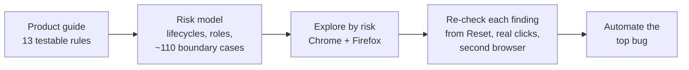
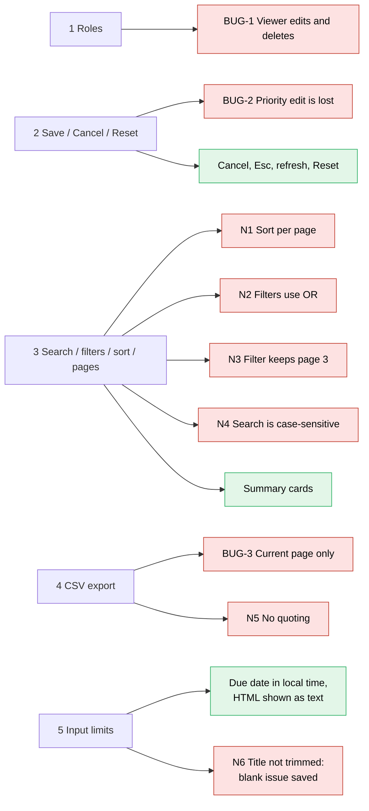
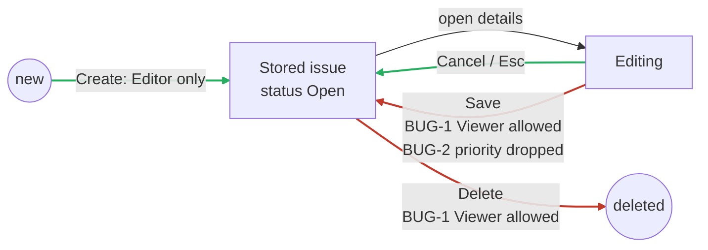
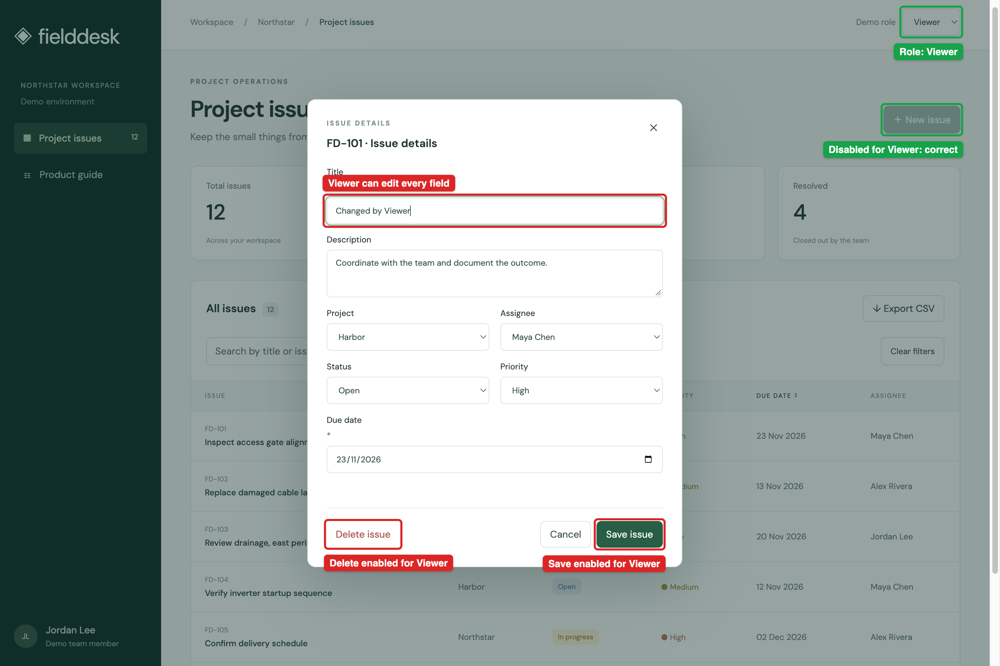
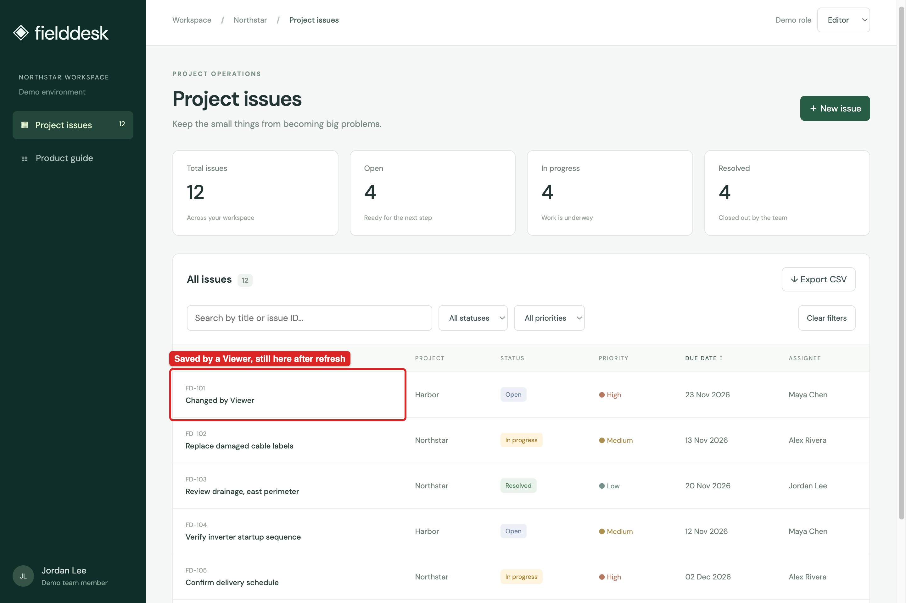
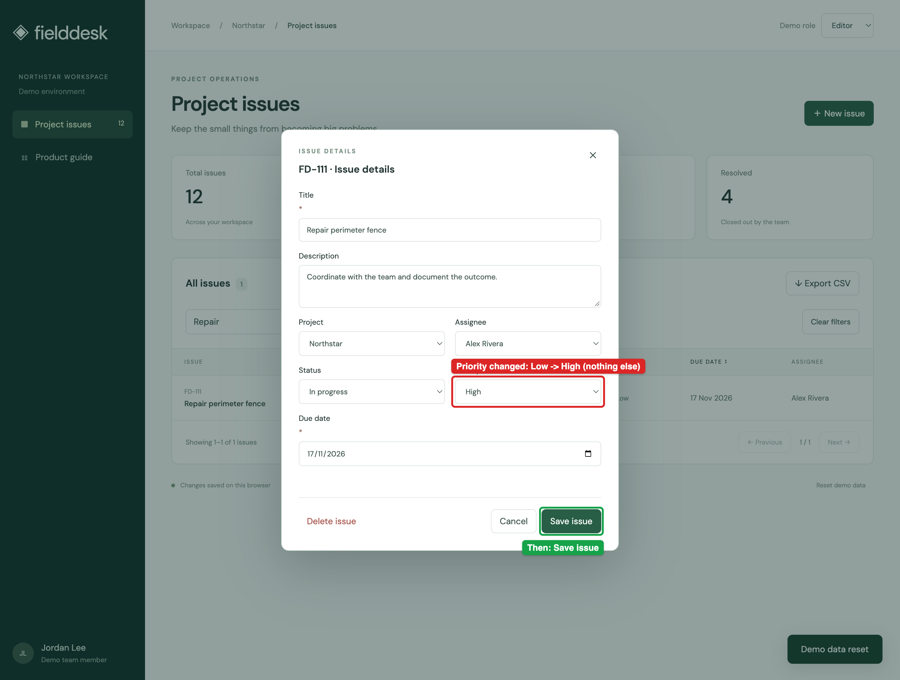
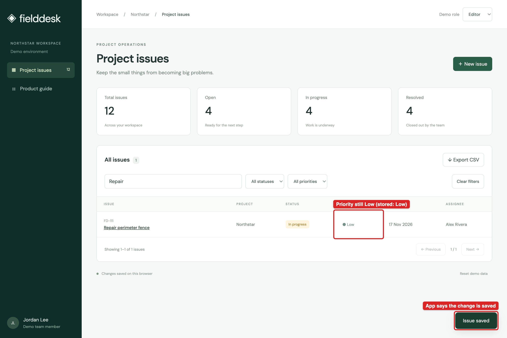
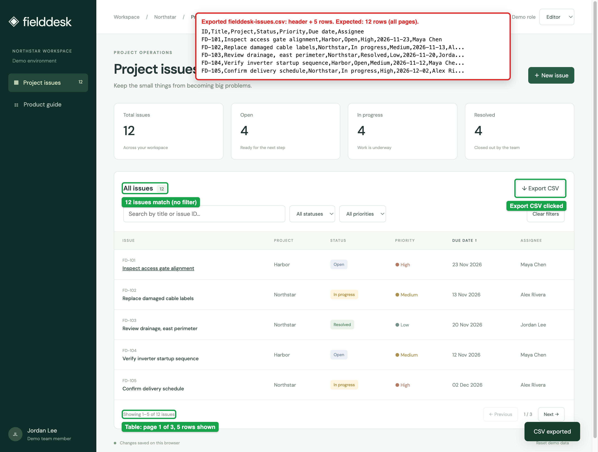
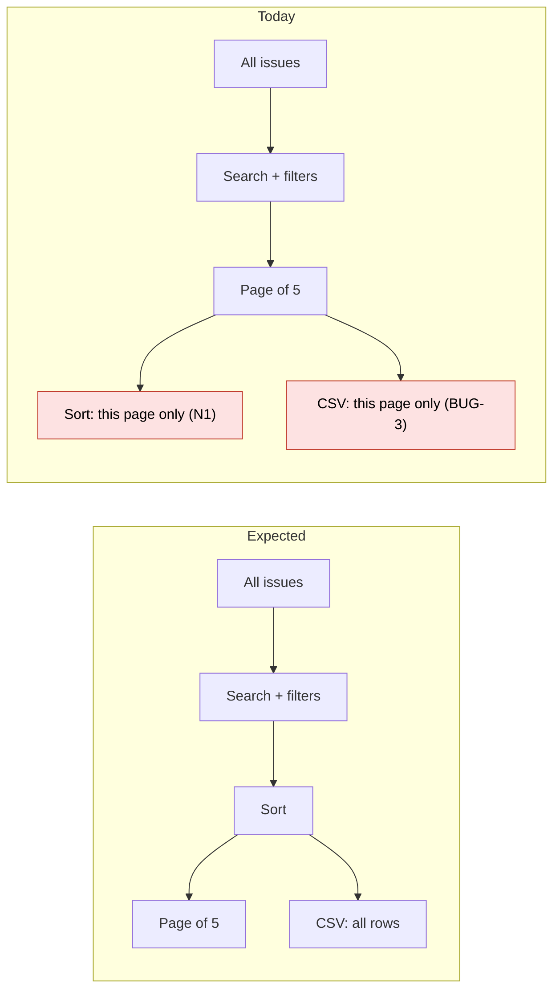
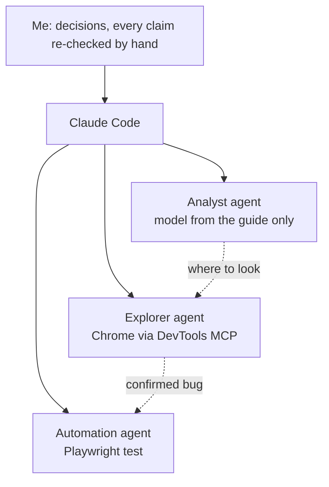

# Fielddesk QA exercise: answers

11 Nov 2026 · Product guide 1.0 · macOS 27.2 · Chrome 157.0.8103.50 · Firefox 159.0.1 · time zone Europe/Paris

## Risks and approach

Risks ranked by what a failure costs, and what I found (red = defect, green = works as the guide says):

Issue lifecycle, each action checked against the guide:

## Bug reports

### BUG-1 · Critical · A Viewer can edit and delete issues

- **Guide:** "Viewers can browse, search, filter, and export, but cannot change issues."
- **Browsers:** Chrome 157.0.8103.50 · Firefox 159.0.1 (reproduced) · automated test on Playwright Chromium 156.0.8078.4
- **Preconditions:** "Reset demo data", Confirm.
- **Steps:**
  1. Demo role: Viewer ("New issue" turns disabled).
  2. Click the title of FD-101, change Title, "Save issue", refresh.
  3. Demo role: Viewer. Open FD-102, "Delete issue", Confirm, refresh.
- **Expected:** for a Viewer the dialog is read-only; nothing changes.
- **Actual:** "Issue saved", the new title survives the refresh. FD-102 is deleted for good (Total 11).
- **Evidence:** screenshots below; delete as Viewer: `evidence/BUG-1-viewer-delete-confirm.png`, `evidence/BUG-1-viewer-after-delete.png`; Playwright trace of ROLE-002.
- **Impact:** the only access control does not hold: any Viewer can rewrite or permanently delete any issue. Reset is the only way back and wipes every other change.

What a Viewer can do today:

| Create | Read | Update | Delete |
|---|---|---|---|
| Blocked by a disabled button only | Allowed (expected) | Allowed, every field | Allowed, permanent |

Likely cause: the role is checked on the "New issue" button, not on save and delete. Saving sends no network request, so the check can only live in the client code.

### BUG-2 · Major · A Priority change is not saved, but the app says "Issue saved"

- **Guide:** "Saved changes survive a page refresh in the same browser."
- **Browsers:** Chrome 157.0.8103.50 · Firefox 159.0.1 (reproduced) · Playwright Chromium 156.0.8078.4 (reproduced by script)
- **Preconditions:** "Reset demo data", Confirm. Role Editor.
- **Steps:**
  1. Open FD-111 "Repair perimeter fence" (Priority Low).
  2. Set Priority to High, "Save issue".
  3. Check the row, reopen the issue, refresh.
- **Expected:** Priority High, also after refresh.
- **Actual:** "Issue saved", but row, dialog and stored data stay Low. Other fields in the same save are kept; creating with High works.
- **Evidence:** screenshots below.
- **Impact:** priority drives triage. An escalation is lost silently while the app confirms it.

### BUG-3 · Major · CSV export contains only the current page

- **Guide:** "CSV export includes all matching issues, across all pages."
- **Browsers:** Chrome 157.0.8103.50 · Firefox 159.0.1 (reproduced)
- **Preconditions:** "Reset demo data", Confirm. No filters: 12 issues, page 1 / 3.
- **Steps:**
  1. "Export CSV".
  2. "Next", "Export CSV" again.
- **Expected:** both files hold all 12 issues.
- **Actual:** file 1 has FD-101 to FD-105, file 2 has FD-106 to FD-110.
- **Evidence:** screenshot below; files `evidence/X-BUG-3-export-from-page1.csv`, `evidence/X-BUG-3-export-from-page2.csv`.
- **Impact:** data leaves the tool silently incomplete.

Likely shared cause with N1 and N3: the list is cut into pages before sort and export.

### Other findings (short notes)

| # | Finding | Guide says |
|---|---|---|
| N1 | Due-date sort orders each page separately: page 1 ends on 02 Dec, page 2 starts on 14 Nov | "orders the complete result set" |
| N2 | Open + High lists 6 issues; only FD-101 matches both | "filters apply together" |
| N3 | On page 3, filtering shows "No matching issues" and "Showing 11-4 of 4" | "starts at the first page" |
| N4 | `inspect` and `fd-104` find nothing; `Inspect` and `FD-104` do | "regardless of letter case" |
| N5 | A title with a comma becomes two columns; quotes are lost | "preserves text containing commas or quotes" |
| N6 | Length is checked before trimming: a spaces-only title is saved, and its row cannot be opened, edited or deleted | "3-80 characters after trimming" |

Works as the guide says: summary cards, new issue starts as Open, Cancel and Esc, refresh, Reset, unique IDs, due date in local time, HTML in a title shown as text.

## Five test scenarios

How I write cases before automating: one line each, "As a role, I can do an action, if a condition", grouped by feature and tier. The bare action is P1; each condition lowers it one level unless data is lost.

Backlog (✅ pass, ❌ defect):

| Tier | Issue | Roles | Find | Export |
|---|---|---|---|---|
| Smoke | Create, see it after refresh · P1 ✅ | | | |
| Sanity | **S2** ❌ / Cancel an edit · P2 ✅ | **S1** ❌ / Viewer browses, exports · P2 ✅ | **S3** ❌ / Search any case · P2 ❌ / Sort across pages · P2 ❌ | **S4** ❌ |
| Edge cases | **S5** ❌ | Not covered: Enter key, role switch with dialog open | Not covered: equal dates on a page edge | Not covered: title starting with `=` |
| Regression | BUG-2, N6 | BUG-1 | N1 to N4 | BUG-3, N5 |

| # | Test case | Type | Tier | Priority | Why it matters | Today |
|---|---|---|---|---|---|---|
| S1 | As a Viewer, I cannot edit or delete an issue | Negative | Sanity | P1 | The only access control | BUG-1 · **automated** |
| S2 | As an Editor, I can edit every field and keep it after refresh | Happy path | Sanity | P1 | Most frequent action; a lost field hides behind "Issue saved" | BUG-2 |
| S3 | I can filter by status and priority together, from page 1 | Happy path | Sanity | P1 | Users act on what the list shows | N2, N3 |
| S4 | I can export every matching issue, readable by a CSV reader | Happy path | Sanity | P1 | Data leaves the tool unchecked | BUG-3, N5 |
| S5 | I can save a title of 3-80 characters and a due date from today, nothing outside | Boundary | Edge cases | P2 | Off-by-one, trim after the check, UTC instead of local | N6 |

S5, each limit on both sides:

| Title | 2 chars | 3 | 80 | 81 | `"  ab  "` | 80 + spaces | spaces only |
|---|---|---|---|---|---|---|---|
| Expected | refused | saved | saved | refused | refused | saved | refused |
| Today | ✅ | ✅ | ✅ | ✅ | ❌ saved | ❌ refused | ❌ saved |

| Due date (local) | yesterday | today | tomorrow | 00:30 Paris, UTC still yesterday |
|---|---|---|---|---|
| Expected | refused | saved | saved | saved |
| Today | ✅ | ✅ | ✅ | ✅ |

## Automation

Scenario S1 is automated with Playwright + TypeScript in [`automation/`](automation/): highest severity, 100% reproducible, checked on stored data. Its tags carry the same axes (`@roles @error-case @p1`).

| Test | Checks | Today |
|---|---|---|
| ROLE-001 control | Editor renames own issue; after reload the stored title changed | Pass |
| ROLE-002 | Viewer does the same; after reload the stored title must be unchanged | Expected failure: BUG-1 |

Run: `cd automation && npm ci && npx playwright install chromium && npm test` (Playwright 1.64.1, Chromium 156.0.8078.4).

- **Assertions:** on stored data (localStorage) after a reload, not on screen text.
- **Isolation:** fresh browser context per test; each test creates its own issue, sample data is never edited.
- **False results:** `test.fail()` covers only the final checks, so a setup failure stays red, and a fix turns the run red until the mark is removed. If the shared edit steps break, the control test fails, so ROLE-002 cannot pass by accident. Other risks (search, storage key, slow demo) are in the [README](automation/README.md).

## Tools and AI

- **Adopted:** the risk model (every defect sits in an area it flagged); scripted reads of storage, CSV and all pages; `test.fail()` for the known bug.
- **Rejected:** two model predictions that failed when tested (date shown a day early, duplicate IDs); design opinions that match the guide.
- **Verified:** each bug reproduced from Reset with real clicks; all three also in Firefox 159.0.1; BUG-1, BUG-2 and N5 confirmed by two agents independently. Fictional data only.

## Not tested, assumptions, next

- **Not tested:** other Viewer paths (Enter key, role switched with the dialog open); two tabs saving at once; sort with equal dates and across a year; accessibility, real mobile devices, Safari.
- **Assumptions** (guide silent): statuses are Open, In progress, Resolved; role and filters may reset on refresh; a Viewer may use Reset.
- **Next:** confirm the pages-before-sort cause with a developer (one fix for BUG-3, N1, N3); automate the other Viewer paths and S2; ask product which status transitions are allowed.
