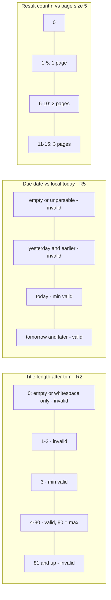

# Boundaries and equivalence classes

Consolidated boundary-value and equivalence-class catalogue for Fielddesk, one row per case, traced to the guide rules R1-R13. "Expected per spec" is what Product guide v1.0 says; where it says nothing, the cell says "guide silent" and the case goes to open questions. Baseline: 12 seed issues FD-101..FD-112, 5 per page, cards 12 / 4 / 4 / 4, today = 2026-11-11 (Europe/Paris).

Priorities: P1 = data loss, permission bypass, or wrong data shown/exported. P2 = wrong behavior with a visible workaround. P3 = cosmetic or out-of-spec risk.

## Rule index

| R-id | rule |
|---|---|
| R1 | Issues belong to Northstar or Harbor; every issue has title, description, priority, status, assignee, due date |
| R2 | Title 3-80 characters after trimming surrounding spaces |
| R3 | Description optional |
| R4 | New issues start as Open |
| R5 | Due date today or future, local calendar date |
| R6 | Editor create/edit/delete; Viewer browse/search/filter/export only |
| R7 | Saved changes survive refresh in the same browser; Cancel discards unsaved changes |
| R8 | Search matches titles and issue IDs, case-insensitive |
| R9 | Status and priority filters AND together; search or filter change goes to page 1 |
| R10 | Due-date sort orders the complete result set, both directions |
| R11 | Summary cards = whole workspace, independent of filters |
| R12 | CSV = all matching issues across all pages; commas and quotes preserved |
| R13 | Reset restores sample issues, clears filters, role back to Editor |

## Input domain partitions

## Catalogue

| id | rule | input / class | expected per spec | priority | why it matters |
|---|---|---|---|---|---|
| FLD-01 | R1 | Project dropdown options | Exactly Northstar and Harbor | P2 | A third project or a free-text project breaks the domain |
| FLD-02 | R1 | Create with priority / assignee left at placeholder, if possible | Rejected or defaulted; every issue has all six fields | P2 | Rows with blank fields break filters and CSV |
| FLD-03 | R1 | Status / priority option lists in create and edit forms | Only Open, In progress, Resolved and High, Medium, Low | P2 | Unknown values vanish from every filter and card |
| TTL-01 | R2 | `ab` (2 chars) | Rejected with validation alert | P2 | Lower boundary, invalid side |
| TTL-02 | R2 | `abc` (3 chars) | Accepted | P2 | Lower boundary, valid side; off-by-one |
| TTL-03 | R2 | 80 chars | Accepted, stored and shown in full | P2 | Upper boundary; silent truncation would be data loss |
| TTL-04 | R2 | 81 chars (typed and pasted) | Cannot be saved (alert or input capped at 80) | P2 | Upper boundary, invalid side |
| TTL-05 | R2 | `  ab  ` (2 after trim, 6 raw) | Rejected | P2 | Proves trim happens before the length check |
| TTL-06 | R2 | `  abc  ` (3 after trim, 7 raw) | Accepted | P2 | Surrounding spaces must not count; stored value trimmed? (open) |
| TTL-07 | R2 | 80 chars + 2 spaces each side (84 raw) | Accepted (80 after trim) | P2 | A raw `maxlength=80` rejects a valid title |
| TTL-08 | R2 | Whitespace only: spaces, tab, NBSP | Rejected (0 after trim) | P2 | Blank-looking issue in the table |
| TTL-09 | R2 | `a b` (3 chars with internal space), `a  b` | Accepted; internal spaces counted, not collapsed | P3 | Only surrounding spaces are trimmed per guide |
| TTL-10 | R2 | 79 letters + 1 emoji; 80 emoji; `e` + combining accent | Guide says "characters": user-perceived count; record behavior | P3 | JS `length` counts UTF-16 units: emoji = 2, valid titles rejected |
| TTL-11 | R2 | Edit existing title to `ab` or 81 chars | Rejected on edit as on create | P2 | Validation often only wired on create |
| TTL-12 | R2 | Title `` | Shown as text (out of spec) | P3 | Self-XSS in title rendering or CSV |
| DSC-01 | R3 | Empty description | Saved | P2 | Optional field must not block save |
| DSC-02 | R3 | Description with comma, quotes, newline | Saved verbatim | P2 | Feeds CSV quoting cases |
| DSC-03 | R3 | Clear an existing description on edit | Saved as empty | P3 | Empty edit sometimes ignored |
| NEW-01 | R4 | Create with Status set to Resolved, if the form offers it | Saved as Open | P2 | Wrong status skews cards |
| NEW-02 | R4 | Create with defaults | Status Open, card Open +1 | P1 | Core create path |
| NEW-03 | R1/R4 | Delete FD-105, then create 2 issues | New IDs unique, no duplicate of a live ID | P1 | count+1 ID scheme yields two FD-113: edit/delete hits both |
| DUE-01 | R5 | Yesterday (2026-11-10) | Rejected | P2 | Lower boundary, invalid side |
| DUE-02 | R5 | Today (2026-11-11) | Accepted | P2 | Lower boundary, valid side; UTC comparison breaks it |
| DUE-03 | R5 | Tomorrow (2026-11-12) | Accepted | P2 | First clearly valid value |
| DUE-04 | R5 | Today, local clock 00:00-00:59 Paris (UTC still yesterday) | Today accepted; local yesterday rejected | P2 | `toISOString()` date makes "today" = UTC date |
| DUE-05 | R5 | TZ where local date != UTC date now (Paris morning: Pacific/Honolulu; Paris evening: Pacific/Auckland) | Local today accepted; stored `YYYY-MM-DD` shown as the same calendar day | P1 | `new Date("2026-11-23")` is UTC midnight: shown as 22 Nov west of UTC (wrong data shown) |
| DUE-06 | R5 | Empty due date | Rejected (field is required, "Due date *") | P2 | Every issue has a due date (R1) |
| DUE-07 | R5 | Invalid: 2026-02-30, 2026-13-01, year 0000, 6-digit year | Rejected or impossible to enter; no "Invalid Date" stored | P2 | Invalid Date breaks sort and display |
| DUE-08 | R5 | Far future 9999-12-31 | Accepted, sorts last ascending | P3 | Numeric overflow or text sort |
| DUE-09 | R5 | Typed past date bypassing date-picker `min` | Rejected on Save | P2 | `min` attribute alone does not validate typed input |
| DUE-10 | R5 | Edit overdue issue (stored past due), change title only | Guide silent | P2 | If R5 runs on edit, overdue issues become uneditable |
| ROL-01 | R6 | Viewer opens details via title link | Read-only, no Save, no Delete | P1 | Observed editable by automation lane (BUG-1 candidate) |
| ROL-02 | R6 | Viewer uses Delete issue in details | Impossible | P1 | Permission bypass with data loss |
| ROL-03 | R6 | Viewer opens `#FD-101` deep link | Read-only dialog | P1 | Second entry point to the same dialog |
| ROL-04 | R6 | Dialog opened as Editor, role switched to Viewer, Save | Blocked | P1 | Stale permission in open modal |
| ROL-05 | R6 | Viewer presses Enter in a dialog field | No submit | P1 | Keyboard submit skips button state |
| ROL-06 | R6 | Viewer: Tab to New issue, Enter / Space | Nothing opens | P1 | Disabled-looking but focusable button |
| ROL-07 | R6 | Viewer: search, filter, sort, page, export | All allowed, same output as Editor | P2 | Positive side of R6 |
| ROL-08 | R6 | Viewer refreshes page | Guide silent; observed back to Editor | P3 | One F5 restores edit rights |
| ROL-09 | R6 | Viewer details: Status, Project, Assignee, Priority, Due date | All non-editable | P1 | Partial lock (title only) still lets status change |
| PER-01 | R7 | Create, refresh | Issue present, all fields intact | P1 | Core persistence |
| PER-02 | R7 | Edit each field type, refresh | All edits kept | P1 | Field missing from the save payload |
| PER-03 | R7 | Delete, refresh | Stays deleted | P1 | Resurrected issue |
| PER-04 | R7 | Edit fields, Cancel, reopen details, refresh | Original values in table, dialog and storage | P1 | In-place mutation before Save leaks the edit |
| PER-05 | R7 | Edit, close with X / Esc / backdrop | Discarded (same as Cancel) | P1 | Close path that saves silently |
| PER-06 | R7 | Dirty form, refresh | Unsaved changes gone, no partial save | P2 | Auto-save on input would contradict Cancel |
| PER-07 | R7 | Storage key set to invalid JSON, refresh | No crash (seed or error) | P2 | White screen, unrecoverable without devtools |
| PER-08 | R7 | Stored issue with status `Closed` / project `Other` | Guide silent | P3 | Cards and filters disagree |
| PER-09 | R7 | Two tabs edit different issues, both save | Both changes kept | P1 | Whole-array rewrite = lost update |
| PER-10 | R7 | Private window session | Seed at start, persists across refresh in session | P3 | Footer claim scope |
| PER-11 | R7 | Storage blocked / quota exceeded | No crash, no false saved state | P3 | `setItem` throw swallowed |
| SRC-01 | R8 | Title word in other case (`LOGIN`, `login`) | Matches | P2 | Case-sensitivity bug |
| SRC-02 | R8 | `fd-101` | Matches FD-101 | P2 | IDs searched case-sensitively |
| SRC-03 | R8 | Partial ID `101`, `FD-10`, `FD-1` | Guide silent (substring?); record | P3 | Defines what "matches IDs" means |
| SRC-04 | R8 | Word only present in a description | NOT matched | P2 | Search scope wider than guide |
| SRC-05 | R8 | Assignee name `Maya` (not in any title) | NOT matched | P2 | Search scope wider than guide |
| SRC-06 | R8 | Project name `Harbor` (not in title) | NOT matched | P3 | Same |
| SRC-07 | R8 | ` fd-101 ` with surrounding spaces | Guide silent; record | P3 | Untrimmed query returns 0 |
| SRC-08 | R8 | `zzzz` (no match) | Empty state, 0 issues, pager disabled | P2 | "Showing 1-0 of 0", broken pager |
| SRC-09 | R8 | Regex chars `(`, `.`, `*`, `[`, `\` | Literal match, no crash | P2 | `new RegExp(q)` throws or matches everything |
| SRC-10 | R8 | New issue searched by its new ID | Found | P2 | Search index built from seed only |
| FLT-01 | R9 | Status Open + priority High | Only rows matching both | P1 | OR instead of AND shows wrong data |
| FLT-02 | R9 | Status + priority combo with 0 matches | Empty state, no stale rows | P2 | Previous rows left on screen |
| FLT-03 | R9 | Search + status + priority | All three applied | P1 | One control silently ignored |
| FLT-04 | R9 | On page 3, filter to 2 results | Page 1, "Showing 1-2 of 2" | P2 | Empty page 3 hides real matches |
| FLT-05 | R9 | On page 2, type a search | Page 1 | P2 | Same, for search |
| FLT-06 | R9 | Clear filters | Status and priority to All, page 1 (search: guide silent) | P2 | Partial clear |
| PAG-01 | R9 | n = 0 | No rows, no "1-0", Next / Previous disabled | P2 | Pager arithmetic at zero |
| PAG-02 | R9 | n = 5 (create 1 Open, filter Open) | 1 page, Next disabled | P2 | Exactly one full page |
| PAG-03 | R9 | n = 6 (create 2 Open, filter Open) | 2 pages, page 2 has 1 row | P2 | First overflow |
| PAG-04 | R9 | n = 10 (delete 2) | 2 pages, no empty page 3 | P2 | `floor(n/5)+1` off-by-one |
| PAG-05 | R9 | n = 11 (delete 1) | 3 pages, page 3 has 1 row | P2 | Overflow by one |
| PAG-06 | R9 | On last page with 1 row, delete it | Moves to previous page | P2 | Stranded on empty page |
| SRT-01 | R10 | Ascending, read pages 1-3 | Page 1 = 5 earliest of all, dates non-decreasing across pages | P1 | Per-page sort shows wrong order |
| SRT-02 | R10 | Descending, read pages 1-3 | Page 1 = 5 latest of all | P1 | Only current page reversed |
| SRT-03 | R10 | 3+ issues with equal due date across rows 5-6 | Each issue on exactly one page | P1 | Unstable sort duplicates / hides rows |
| SRT-04 | R10 | Sort ascending, then apply a filter | Filtered rows still sorted (if sort stays active) | P2 | Sort dropped on filter change |
| SRT-05 | R10 | Dates across month and year: 5 Dec 2026, 12 Dec 2026, 1 Jan 2027 | Chronological | P1 | Sort on display string or day number |
| SRT-06 | R10 | Sort active, create or edit a due date | Row moves to sorted position | P2 | Stale sorted list |
| SRT-07 | R10 | Toggle sequence asc / desc / ? | Both directions available | P3 | Third state undefined |
| SUM-01 | R11 | Apply status or priority filter | Cards still 12 / 4 / 4 / 4 | P1 | Cards computed from filtered list |
| SUM-02 | R11 | Search with 0 results, page 2 or 3 | Cards unchanged | P1 | Cards computed from visible page |
| SUM-03 | R11 | Create issue | Total 13, Open 5 | P1 | Cards not recomputed |
| SUM-04 | R11 | Edit status Open to Resolved | Open 3, Resolved 5, Total 12 | P1 | Stale counts |
| SUM-05 | R11 | Delete an In progress issue | Total 11, In progress 3 | P1 | Stale counts |
| SUM-06 | R11 | Edit status, then Cancel | Cards unchanged | P1 | Cancel leaks into cards |
| SUM-07 | R11 | Any state | Open + In progress + Resolved = Total | P2 | Hidden or unknown status |
| CSV-01 | R12 | No filter, export | Header + 12 rows | P1 | Only current page exported |
| CSV-02 | R12 | Multi-page result set, export from page 1 and from page 2 | All matching rows both times | P1 | Export tied to current page |
| CSV-03 | R12 | Filter to 4 rows, export | Exactly those 4 rows | P1 | Whole workspace exported |
| CSV-04 | R12 | Title `Fix login, signup` | One field, quoted, comma kept | P1 | Column shift in spreadsheet |
| CSV-05 | R12 | Title `Say "hi" now` | Quoted, inner quotes doubled `""` | P1 | Broken row or lost quotes |
| CSV-06 | R12 | Description with a newline | Quoted, row stays one record | P2 | Beyond guide wording, same mechanism |
| CSV-07 | R12 | Title `=1+1` or `=HYPERLINK(...)` | Out of spec: record whether escaped | P3 | CSV formula injection when opened in Excel |
| CSV-08 | R12 | 0 matching issues, export | Header only, or export disabled; never all issues | P2 | Empty filter falls back to everything |
| CSV-09 | R12 | Export as Viewer | Allowed, same file as Editor | P2 | Positive side of R6 |
| CSV-10 | R12 | Non-ASCII title (accents, emoji) | Preserved (UTF-8) | P3 | Mojibake in Excel without BOM |
| CSV-11 | R12 | Export with a dirty, unsaved form open | Saved data only | P2 | Unsaved edit leaks into export |
| CSV-12 | R12 | Export with sort active | Guide silent on order; record | P3 | Order mismatch confuses users |
| RST-01 | R13 | Create + edit + delete, then Reset | Exactly the 12 original seed issues, original values | P1 | Partial restore |
| RST-02 | R13 | Reset with search + status + priority active | Filters cleared, controls show All, page 1 | P2 | Controls show a filter that is no longer applied, or vice versa |
| RST-03 | R13 | Reset as Viewer | Guide silent; if allowed, role becomes Editor | P1 | Viewer rewrites all data |
| RST-04 | R13 | Reset as Viewer (if allowed) | Role combobox shows Editor | P2 | Role not reset |
| RST-05 | R13 | Reset with sort active | Guide silent (sort is not a filter) | P3 | Undefined |
| RST-06 | R13 | Reset on page 3 | Page 1 | P2 | Stranded page |
| RST-07 | R13 | Reset, then refresh | Still seed; old edits do not return | P1 | Reset only in memory, storage keeps old data |
| RST-08 | R13 | Reset, then create | New ID does not collide with seed IDs | P2 | ID counter not reset |

## Top P1 cases (initial pick, spec only)

| order | id | rule | why first |
|---|---|---|---|
| 1 | ROL-02 | R6 | Extends the BUG-1 candidate from edit to delete; also check ROL-03 and ROL-09 in the same pass |
| 2 | SRT-01 | R10 | Per-page sort is cheap to spot on the 3 seed pages; add SRT-03 / SRT-05 if dates allow |
| 3 | CSV-02 | R12 | Export from page 2 with no filter; same file gives CSV-04 / CSV-05 once a comma/quote title exists |
| 4 | SUM-01 | R11 | One filter click, compare cards with 12 / 4 / 4 / 4 |
| 5 | PER-04 | R7 | Edit, Cancel, reopen: in-place mutation is a common planted bug and is data loss |

## Results after exploration (IDs as in `../SUBMISSION.md`)

| Cases | Result |
|---|---|
| ROL-01, ROL-02, ROL-09 | BUG-1 |
| PER-02 | BUG-2 (priority is not saved on edit) |
| CSV-01, CSV-02 | BUG-3 |
| SRT-01, SRT-02 | N1 |
| FLT-01 | N2 |
| FLT-04 | N3 |
| SRC-01, SRC-02, SRC-07 | N4 |
| CSV-04, CSV-05 | N5 |
| TTL-05, TTL-07, TTL-08 | N6 |
| TTL-01..04, TTL-06, DUE-01..04, NEW-02, NEW-03, PER-04, PER-05, SUM-01..04, RST-01..03, RST-07 | Pass |

Two predictions did not hold: DUE-05 (date shown a day early west of UTC) and NEW-03 (duplicate IDs).

## Open questions for exploration

1. Is the stored title trimmed? Is "characters" counted as UTF-16 units or user-perceived characters (emoji)?
2. Does R5 apply on edit (overdue issue editable without moving the date)?
3. Is search substring-based for IDs ("FD-10")? Is the query trimmed?
4. Does a sort change reset to page 1? What is the tie-breaker for equal dates?
5. Does Clear filters / Reset also clear search and sort?
6. Do X / Esc / backdrop close behave like Cancel (discard), and does a dirty form warn on refresh?
7. Does the CSV follow the table sort, and which columns / date format does it use?
8. How are new IDs generated, and can a delete-then-create produce a duplicate?
