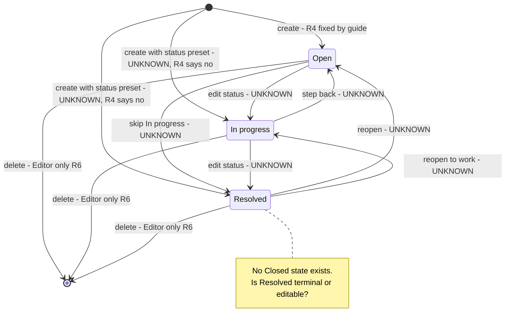
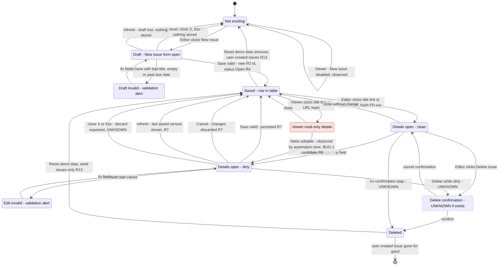

# Issue lifecycle model

Two lifecycles of one issue: its business status (Open / In progress / Resolved) and its record life in the UI (form, save, edit, cancel, delete). Built from Product guide v1.0 plus observed facts only; anything the guide does not fix is marked UNKNOWN and listed as an open question.

Sources: guide rules R1-R13 (see `boundaries.md`), first-load observation (2026-11-11, Chrome, Europe/Paris), automation lane notes in `../NOTES.md` (storage key, details dialog locators, Viewer edit candidate).

## 1. Status lifecycle

Guide fixes only two things: the three statuses exist (observed: filter offers Open / In progress / Resolved, no Closed) and a new issue starts as Open (R4). Every transition between statuses is UNKNOWN.

Reading guide: only `[*] --> Open` and the Editor-only deletes come from the guide. Every edge marked UNKNOWN is a question for exploration: record what the Status combobox in the details dialog offers from each state.

## 2. Record lifecycle (UI)

Guide-backed edges: create as Open (R4), Editor-only create/edit/delete (R6), Save survives refresh and Cancel discards (R7), Reset restores the original sample issues (R13). Everything else in the diagram is an expectation to check, not a rule.

## Boundary and edge cases

Full catalogue with priorities is in `boundaries.md`; this table keeps the lifecycle-specific ones.

| id | case | expected per guide | priority |
|---|---|---|---|
| NEW-01 | Create form offers a Status field; pick Resolved, save | Saved as Open (R4) | P2 |
| NEW-03 | Delete FD-105 (not the last), create two issues | New IDs unique, never reuse a live ID (no duplicate FD-113) | P1 |
| RST-08 | Create after Reset | No collision with restored seed IDs FD-101..112 | P2 |
| LIF-01 | Open -> Resolved -> Open via Status combobox | Guide silent: record what is allowed | P3 |
| LIF-02 | Edit status, then Cancel | Status, row and summary cards unchanged (R7, R11) | P1 |
| LIF-03 | Edit title, close with X / Esc instead of Cancel | Treated as Cancel (expected), nothing saved | P1 |
| LIF-04 | Edit, refresh before Save | Last saved values shown, no partial save | P2 |
| LIF-05 | Edit fields, then Delete while dirty | Issue deleted, no ghost save of the edit | P2 |
| LIF-06 | Delete, refresh | Issue stays deleted (R7) | P1 |
| LIF-07 | Delete a seed issue, Reset | Seed issue back with original values (R13) | P1 |
| LIF-08 | Open details of an issue whose stored due date is now in the past, change title only | Guide silent whether R5 blocks the save | P2 |
| ROL-01 | Viewer opens details via title link | Read-only, no Save / Delete (R6). Observed editable | P1 |

## Open questions for exploration

1. Which status transitions does the details dialog allow? Can Resolved go back to Open or In progress? Is any status locked?
2. Does the New issue form show a Status field at all? If yes, can a new issue be saved directly as In progress or Resolved?
3. How are new IDs generated (max+1, count+1, timestamp)? Does deleting a middle issue then creating one produce a duplicate ID?
4. Is there a delete confirmation step? Does Esc / backdrop click on it cancel the delete?
5. Do close (X), Esc and backdrop click behave like Cancel (discard), or do they save, or keep the dirty state?
6. Does R5 (today or future) also apply on edit? Can an overdue issue still be edited without moving its date?
7. Is the stored title trimmed, or saved with its surrounding spaces?
8. Does a dirty form warn on refresh / tab close (beforeunload), or lose the changes silently?
