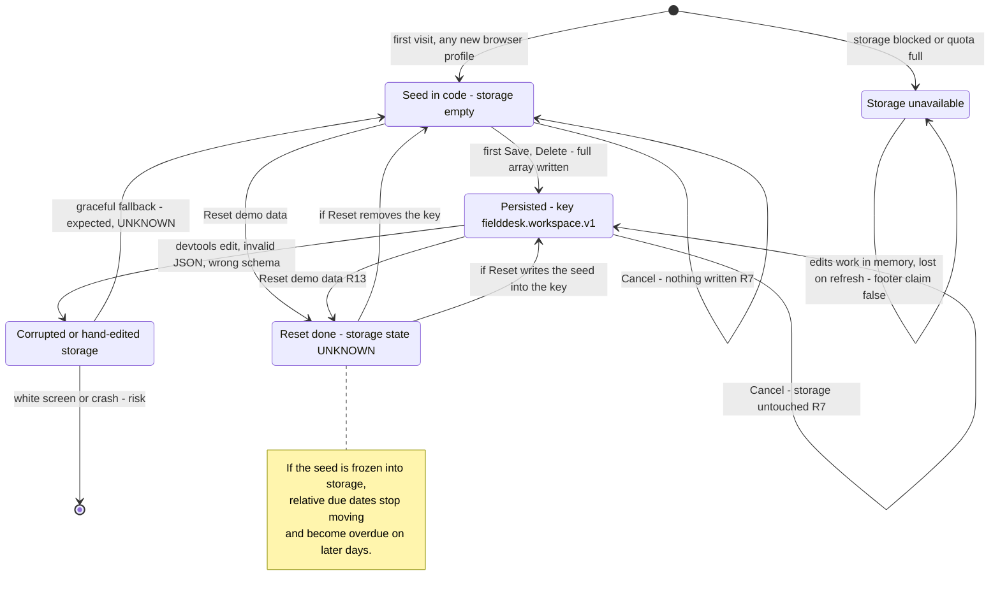
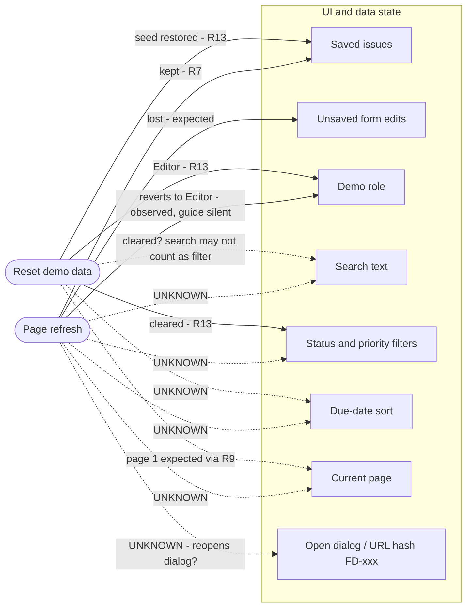

# Persistence lifecycle model

Where the workspace data and the UI state live over time: seed in code, first write to localStorage, refresh, Reset, and the risky paths (corrupted storage, two tabs, private window). Guide basis: R7 (saved changes survive refresh in the same browser, Cancel discards) and R13 (Reset restores sample issues, clears filters, role back to Editor).

Known facts: localStorage is EMPTY on first load. Automation lane (`../NOTES.md`): key `fielddesk.workspace.v1`, JSON array of `{id,title,description,project,status,priority,assignee,due:"YYYY-MM-DD"}`, written on first save; role is NOT stored (reload brings Editor back); seed due dates are relative to today.

## 1. Data lifecycle

## 2. UI state across refresh and Reset

What the guide fixes vs. what is unknown. Reset must clear filters and set role to Editor (R13). Refresh must keep saved changes (R7). Nothing else is specified.

Solid edge = fixed by guide or already observed. Dashed edge = open question.

## 3. Risky paths

| path | scenario | expected | risk if wrong |
|---|---|---|---|
| Corrupted storage | Replace key value with `{bad json`, refresh | App loads (seed or clear error), no white screen | Total loss of UI, user cannot recover without devtools |
| Wrong schema | Stored issue with `status:"Closed"`, `project:"Other"`, 200-char title, past due, missing field | Guide silent; record rendering, cards, filters | Summary cards no longer add up, filters hide rows |
| Duplicate IDs in storage | Two items with `id:"FD-101"` | Guide silent; record which one edit/delete hits | Edit or delete touches both rows |
| Two tabs, lost update | Tab A edits FD-101, tab B (opened before) edits FD-102 and saves | Both changes kept | Tab B rewrites the whole array and silently drops tab A's change |
| Two tabs, stale view | Tab A deletes FD-103, tab B still shows it and edits it | Guide silent | Deleted issue resurrected by tab B's save |
| Private window | Fresh private window | Starts from seed; changes survive refresh inside the session, gone after close | Footer "Changes saved on this browser" over-promises |
| Storage blocked | Block site data / quota exceeded | App still usable, ideally warns | `setItem` throws, Save appears to work but nothing is persisted |
| Reset not persisted | Edit, Reset, refresh | Still seed after refresh | Old edited data comes back after refresh |
| Seed frozen by write | Persist on day N, reopen on day N+1 | Guide silent | "Tomorrow" seed issue becomes overdue; Reset may or may not refresh the dates |
| Key version | Key is `.v1` | Guide silent | Future v2 migration may wipe user data (out of scope, note only) |

## Boundary and edge cases

| id | case | expected per guide | priority |
|---|---|---|---|
| PER-01 | Create, refresh | Issue present with all fields | P1 |
| PER-02 | Edit, refresh | Edit kept | P1 |
| PER-03 | Delete, refresh | Stays deleted | P1 |
| PER-04 | Edit, Cancel, reopen details, refresh | Old values everywhere, storage unchanged | P1 |
| PER-06 | Dirty form, refresh | Unsaved changes gone, no partial save | P2 |
| PER-07 | Invalid JSON in key, refresh | No crash | P2 |
| PER-09 | Two tabs, edit different issues, save both | No lost update | P1 |
| PER-10 | Private window round trip | Seed on open, persists within session | P3 |
| PER-11 | Storage blocked | No crash, no false "saved" claim | P3 |
| RST-01 | Create + edit + delete, then Reset | Exactly the 12 original seed issues | P1 |
| RST-07 | Reset, then refresh | Still the seed, edits do not come back | P1 |
| ROL-08 | Switch to Viewer, refresh | Guide silent; observed back to Editor | P3 |

## Open questions for exploration

1. Does Reset remove `fielddesk.workspace.v1` or write the seed into it? Check storage right after Reset.
2. Do search, filters, sort and page survive a refresh (URL params, storage, or nothing)?
3. Does an open details dialog or a `#FD-xxx` hash reopen the dialog after refresh?
4. Is role reverting to Editor on refresh intended (guide silent)? It hands edit rights back to a Viewer with one F5.
5. What happens on invalid JSON or unknown status/project values in storage: fallback, partial render, or crash?
6. Does the app listen to `storage` events (two tabs in sync) or does the last save win with a stale array?
7. With storage blocked, does Save throw visibly or fail silently?
8. Are seed due dates recomputed after Reset, or frozen at the date of the first write?
