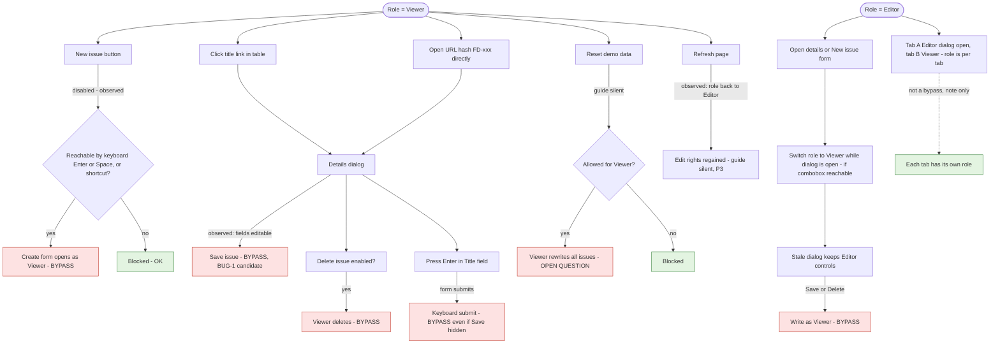

# Roles model

Permission matrix for the two simulated roles and every entry point through which a Viewer could still change data. Guide basis: R6 (Editors create, edit, delete; Viewers browse, search, filter, export, but cannot change issues) and R13 (Reset returns the role to Editor). The app is client-only, so every check is a UI check: the question is whether the UI enforces R6 on every path, not whether it is tamper-proof.

Known facts: role is a "Demo role" combobox (Editor / Viewer). As Viewer, "New issue" is disabled. Automation lane (`../NOTES.md`): as Viewer, clicking a title link opens the details dialog with every field editable and Save issue / Delete issue enabled; a Viewer save is persisted and survives reload (BUG-1 candidate). Role is not stored: reload returns to Editor.

## 1. Permission matrix

| action | Editor | Viewer | source | observed |
|---|---|---|---|---|
| Browse table, open details | yes | yes, read-only | R6 | Viewer details editable, incl. Status (BUG-1) |
| Search | yes | yes | R6 | - |
| Filter status / priority | yes | yes | R6 | - |
| Sort by due date | yes | yes (implied by browse) | R6 implied | - |
| Paginate | yes | yes (implied by browse) | R6 implied | - |
| Export CSV | yes | yes | R6 | - |
| Create issue | yes | no | R6 | New issue disabled |
| Edit issue | yes | no | R6 | Viewer can edit via details (BUG-1) |
| Delete issue | yes | no | R6 | Viewer can delete after in-app confirm (BUG-1, confirmed) |
| Clear filters | yes | yes (view only) | R9 implied | - |
| Reset demo data | yes (R13) | UNKNOWN - guide silent | R13 | Allowed as Viewer, role back to Editor (exploration) |
| Switch role | yes | yes | Demo data section | - |

Conflict to flag: Reset rewrites every issue back to the seed. If a Viewer can press Reset, a Viewer can change (and wipe) data, which contradicts "cannot change issues". If Reset is blocked for Viewers, a Viewer cannot get back to Editor via Reset (role switch still works).

## 2. Viewer write entry points

Out of scope by design: editing localStorage or enabling a disabled button in devtools. There is no server, so these are not R6 findings.

## Boundary and edge cases

| id | case | expected per guide | priority |
|---|---|---|---|
| ROL-01 | Viewer opens details via title link | Read-only fields, no Save, no Delete | P1 |
| ROL-02 | Viewer clicks Delete issue in details | Delete impossible (button absent or disabled) | P1 |
| ROL-03 | Viewer opens `#FD-101` directly | Same read-only dialog as ROL-01 | P1 |
| ROL-04 | Editor opens details or New issue form, switches to Viewer, saves | Save blocked or dialog closed on role change | P1 |
| ROL-05 | Viewer presses Enter inside a dialog field | No submit, no write | P1 |
| ROL-06 | Viewer focuses New issue with Tab, presses Enter / Space | Nothing opens | P1 |
| ROL-07 | Viewer searches, filters, sorts, paginates, exports | All work, same results as Editor | P2 |
| ROL-08 | Viewer refreshes | Guide silent; observed back to Editor | P3 |
| ROL-09 | Viewer opens details: Status, Project, Assignee comboboxes and Due date | All disabled, not only the title | P1 |
| RST-03 | Viewer presses Reset demo data | Guide silent; if allowed, role becomes Editor (R13) | P1 |

## Open questions for exploration

1. Can a Viewer delete from the details dialog (confirm BUG-1 scope beyond edit)?
2. Does a direct `#FD-xxx` link open the dialog for a Viewer, and with which controls?
3. Is the role combobox reachable while a dialog is open (modal focus trap)? If yes, does the dialog update on role change?
4. Does Enter in the Title field submit the form regardless of role?
5. Is Reset demo data enabled for a Viewer? If yes, does it switch the role to Editor as R13 says?
6. Is role reverting to Editor on refresh intended?
7. Is the Viewer read-only state identical in Firefox (automation evidence is Chromium only)?
