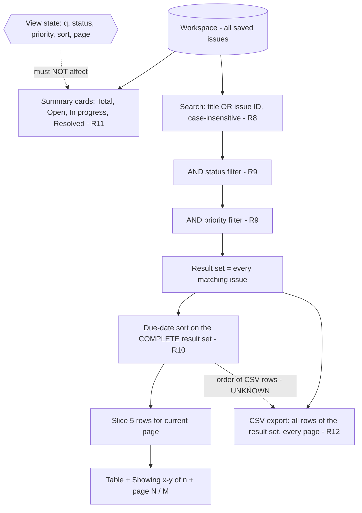
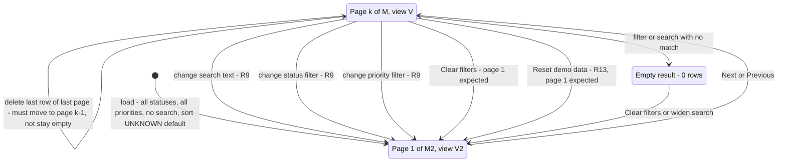

# View state model

Search, status filter, priority filter, due-date sort and page treated as one view state that turns the workspace into a table page, a CSV file and summary cards. Guide basis: R8 (search), R9 (filters AND, reset to page 1), R10 (sort on the complete result set), R11 (cards independent of filters), R12 (CSV = all matching rows).

Observed baseline: 12 issues, 5 per page, 3 pages, "Showing 1-5 of 12 issues", "1 / 3". Statuses 4 / 4 / 4.

## 1. Data pipeline (what each output must depend on)

Invariants to assert on every step:

- Cards are a function of the workspace only: changing q / status / priority / sort / page never changes them; create, edit status, delete always do.
- Result set = search AND status AND priority. Never OR, never ignoring one control.
- Sort happens before the page slice. Page 1 ascending = the 5 earliest due dates of the whole result set.
- Each issue of the result set appears on exactly one page (no duplicates, no gaps), also with equal due dates.
- CSV row count = n in "Showing x-y of n", regardless of the current page.

## 2. View-state transitions

## 3. Interaction risks

| risk | steps | expected per guide | typical bug |
|---|---|---|---|
| Page 3 then narrow filter | Go to page 3 of 12, filter to 2 results | Page 1, "Showing 1-2 of 2", "1 / 1" (R9) | Stays on page 3: empty table, "Showing 11-2 of 2" |
| Sort then filter | Sort ascending, then filter status | Filtered rows still in ascending order if sort stays active (R10) | Sort indicator on, rows back in ID order |
| Sort + pagination | Sort ascending, read pages 1-3 | Dates non-decreasing across page boundaries (R10) | Each page sorted on its own: page 2 starts earlier than page 1 ends |
| Equal due dates across a page boundary | Make 3 issues share a date straddling rows 5-6 | Every issue once across pages | Unstable sort: one row on two pages, another never shown |
| Sort on display string | Dates across month or year (5 Dec 2026, 12 Dec 2026, 1 Jan 2027) | Chronological (R10) | Sorted as text "12 Dec" < "5 Dec", or by day number |
| Descending direction | Toggle to descending | Latest due first, across all pages (R10) | Only reverses current page, or reverses ID order |
| Search + filters | Search "fd-1" + status Open + priority High | All three apply (R8 + R9) | Search ignored while a filter is active, or vice versa |
| Cards follow filters | Filter Resolved | Cards still 12 / 4 / 4 / 4 (R11) | Cards show filtered counts |
| CSV of current page | On page 1 of 12, export | 12 data rows (R12) | 5 rows |
| CSV ignores filters | Filter to 4 rows, export | 4 data rows (R12: matching issues) | Whole workspace exported |
| Edit inside a filtered view | Filter Open, change one row to Resolved | Guide silent | Row stays visible with wrong status, or count and pager not updated |
| Create while sorted | Sort ascending, create issue due tomorrow | Appears in sorted position | Appended at the end or page 1 regardless of sort |

## How to reach the pagination boundaries from the 12 seed issues

| target n | how |
|---|---|
| 0 | Search `zzzz` |
| 4 | Status = any one status (4 each) |
| 5 | Create 1 Open issue, filter Open |
| 6 | Create 2 Open issues, filter Open |
| 10 | Delete 2 issues, no filter |
| 11 | Delete 1 issue, no filter |
| 12 | Seed, no filter |
| 13 | Create 1 issue, no filter |

## Boundary and edge cases

Full rows with priorities in `boundaries.md` (FLT-, PAG-, SRT-, SUM-, CSV-, SRC-).

| id | case | expected | priority |
|---|---|---|---|
| FLT-01 | Status Open + priority High | Only rows matching both | P1 |
| FLT-04 | Page 3, then filter to 2 results | Page 1 with 2 rows | P2 |
| PAG-01..05 | n = 0, 5, 6, 10, 11 | Correct page count, no empty last page, no "1-0" | P2 |
| PAG-06 | Delete the only row on the last page | Moves to previous page | P2 |
| SRT-01 | Ascending, read page 1 | 5 earliest of the whole set | P1 |
| SRT-03 | Equal due dates across pages | No duplicate, no missing row | P1 |
| SRT-05 | Dates across month and year | Chronological | P1 |
| SUM-01 | Any filter or search | Cards unchanged | P1 |
| CSV-02 | Export on page 1 of a multi-page set | All matching rows | P1 |

## Open questions for exploration

1. Does changing the sort direction reset to page 1? The guide only says search and filters do.
2. Does Clear filters also clear the search text and the sort?
3. What is the tie-breaker for equal due dates (ID, insertion order, none)? Is it stable across page changes?
4. Default sort on load: none (ID order) or due date? What does the third click on DUE DATE do?
5. Does the CSV follow the table sort order, and does it contain description and ISO dates or display dates?
6. Is search a substring match ("FD-10" hits FD-101..109) or exact for IDs? Is the query trimmed?
7. After editing a row so it no longer matches the active filter, does it disappear immediately?
8. What does the pager show for 0 results ("0 / 0", "1 / 1", hidden)?
